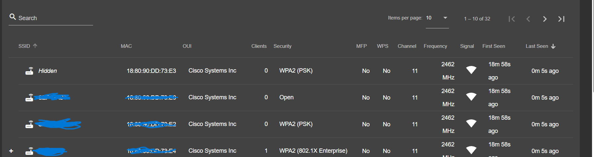
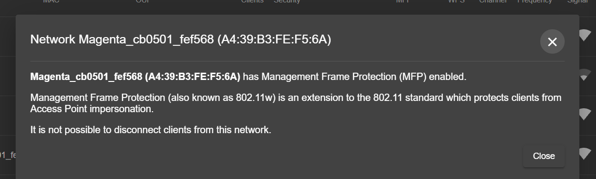
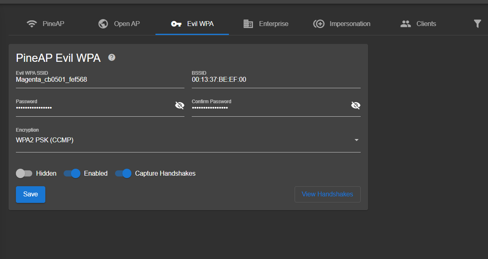
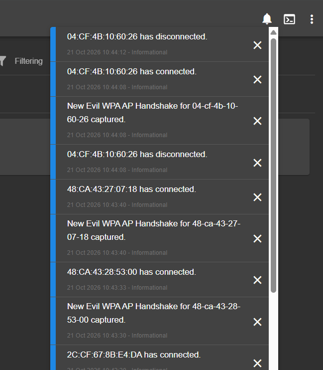
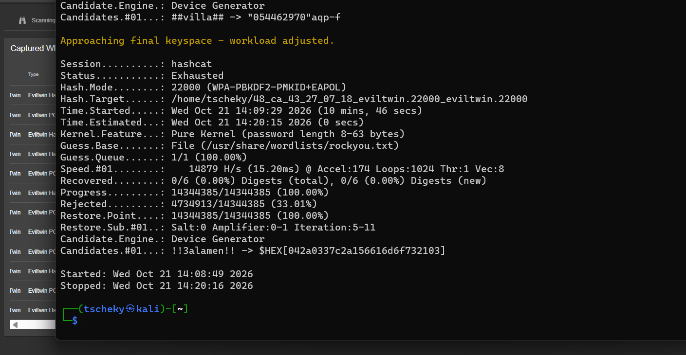
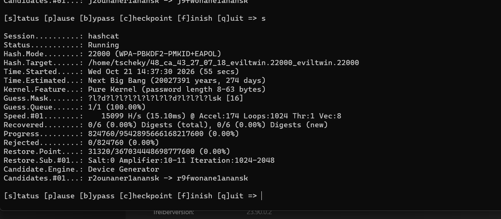

# WLAN-Sicherheitsanalyse mit dem WiFi Pineapple

Praktische Untersuchung der WPA2/WPA3-Sicherheit im eigenen Heimnetz. Das Projekt dokumentiert eine vollständige Angriffskette, von der Erfassung der Funknetze über das Abfangen eines WPA-Handshakes bis zum Versuch, diesen offline zu knacken, und endet mit der Bewertung der Schutzmechanismen.

Durchgeführt im Rahmen der Ausbildung zum IT-Netzwerktechniker am Schulungszentrum Fohnsdorf.

## Kurzfassung

Ziel war es nachzuvollziehen, wie real die Bedrohung durch WLAN-Angriffe ist und welche Schutzmaßnahmen tatsächlich greifen. Das zentrale Ergebnis: Ein Handshake lässt sich auch gegen moderne Schutzmechanismen abfangen, aber ein ausreichend langes Passwort macht das anschließende Knacken praktisch unmöglich.

| Schritt | Methode | Ergebnis |
|---|---|---|
| Netzaufklärung | Recon-Scan | Access Points und Clients erfasst |
| Deauthentication | Klassischer Deauth | Blockiert durch Management Frame Protection (802.11w) |
| Handshake abfangen | Evil-WPA-Twin | Erfolgreich, MFP umgangen |
| Offline-Angriff Wörterbuch | hashcat mit rockyou | Kein Treffer, Passwort nicht in Leak-Listen |
| Offline-Angriff Brute-Force | hashcat Maske | Geschätzte Laufzeit über 20 Millionen Jahre |

## Eingesetzte Technik

Als Hardware kam ein Hak5 WiFi Pineapple (Firmware 2.1.3) zum Einsatz, die Auswertung lief auf einer Kali-Linux-Umgebung. Verwendete Werkzeuge waren hashcat für den Offline-Angriff auf WPA-Handshakes, John the Ripper als Vergleichswerkzeug sowie Hydra zur Demonstration eines Online-Angriffs gegen einen SSH-Dienst.

## Ablauf

### Netzaufklärung

Im ersten Schritt wurden die umliegenden Funknetze erfasst und nach Verschlüsselung, Kanal, verbundenen Clients und aktiver Management Frame Protection ausgewertet. Der eigene Router diente als Ziel, ein zweites eigenes Gerät als verbundener Client.

### Management Frame Protection als erste Hürde

Der klassische Deauthentication-Angriff, mit dem man einen Client zur Neuanmeldung zwingt, scheiterte. Der eigene Router hat 802.11w (Management Frame Protection) aktiv, wodurch gefälschte Deauth-Pakete vom Client verworfen werden. Dies ist ein moderner Schutzmechanismus, der bei WPA3 verpflichtend ist.

### Handshake über einen Evil Twin abfangen

Statt den Deauth zu erzwingen, wurde ein Evil-WPA-Twin aufgebaut, also ein zweiter Access Point mit identischem Namen, gleichem Verschlüsselungstyp und demselben Passwort. Für ein Endgerät ist dieser Zwilling vom Original nicht zu unterscheiden. Sobald sich ein Gerät verbindet, fällt der WPA-Handshake an und wird mitgeschnitten, ganz ohne Deauthentication und damit an MFP vorbei.

### Offline-Angriff auf den Handshake

Der gefangene Handshake wurde mit zwei Ansätzen angegriffen. Der Wörterbuchangriff mit hashcat gegen die bekannte Liste rockyou (rund 14 Millionen Passwörter) lief vollständig durch, ohne das Passwort zu finden.

Der anschließende Brute-Force-Angriff gegen das 16-stellige Passwort ergab eine geschätzte Rechenzeit von über 20 Millionen Jahren. Selbst ein Supercomputer bräuchte dafür noch Zehntausende von Jahren.

## Wichtigste Erkenntnisse

Ein Handshake lässt sich mit vertretbarem Aufwand abfangen, selbst Management Frame Protection verhindert das nicht zuverlässig. Entscheidend für die Sicherheit ist deshalb nicht das Abfangen, sondern die Stärke des Passworts. Ein langes, zufälliges Passwort macht sowohl Wörterbuch- als auch Brute-Force-Angriffe praktisch aussichtslos. Kurze oder in Leak-Listen enthaltene Passwörter fallen dagegen in Sekunden.

## Schutzmaßnahmen

Aus der Analyse ergeben sich konkrete Empfehlungen für die Absicherung eines WLAN:

Ein langes, zufälliges WPA2- oder WPA3-Passwort von mindestens 16 Zeichen verwenden und keine Wörter aus bekannten Listen.

WPA3 mit verpflichtender Management Frame Protection einsetzen, wo die Geräte es unterstützen.

Keine offenen Gastnetze mit sensiblen Diensten verbinden und auf dem Endgerät das automatische Verbinden mit bekannten Netzen kritisch prüfen.

Bei Diensten wie SSH zusätzlich auf Schlüssel statt Passwörter, Rate-Limiting und Fail2ban setzen.

## Ausführliche Dokumentation

Die einzelnen Phasen sind als ausführliche Berichte im PDF-Format dokumentiert:

[Netzwerkanalyse und Erfassung](docs/WiFi_Pineapple_Netzwerkanalyse.pdf)

[Evil-Twin-Angriff und Handshake-Erfassung](docs/Evil_Twin_Angriff.pdf)

[Handshake-Auswertung mit Kali Linux](docs/Handshake_Knacken_Kali.pdf)

## Rechtlicher Hinweis

Sämtliche Tests wurden ausschließlich am eigenen WLAN, an eigenen Geräten und an selbst erstellten Testzielen durchgeführt. Angriffe auf fremde Netze oder Geräte sind in Österreich strafbar und ausschließlich mit ausdrücklicher Erlaubnis des Betreibers zulässig. Dieses Projekt dient der Ausbildung und dem Verständnis von Verteidigungsmaßnahmen.

